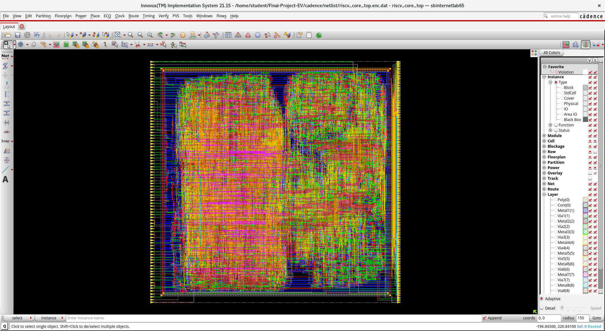
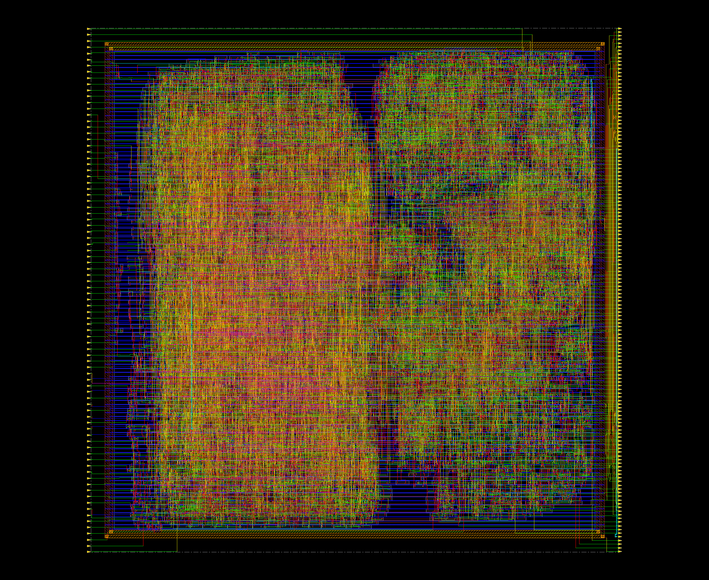
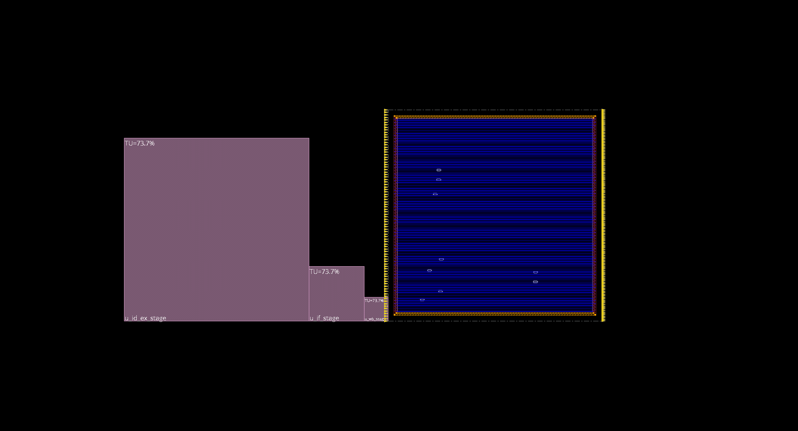
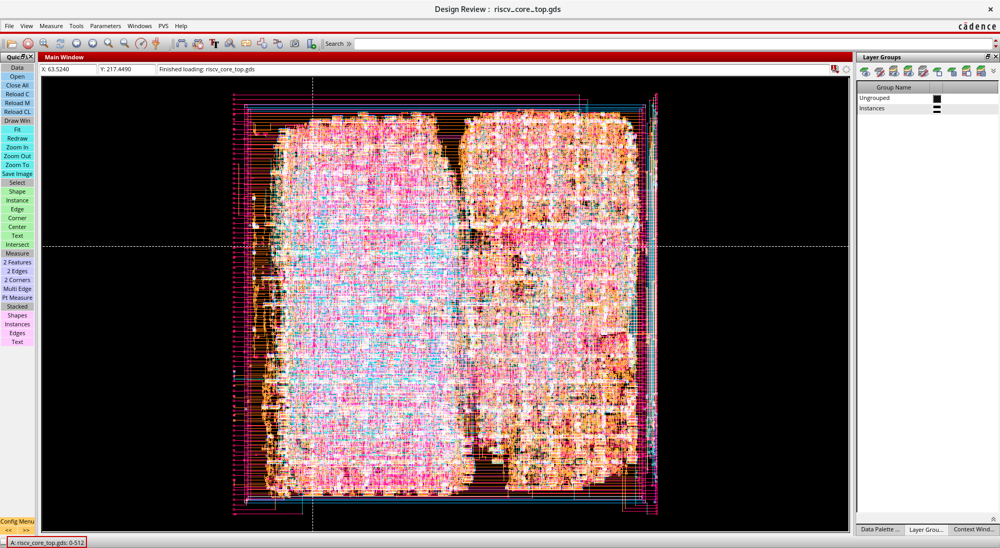

# RV32E Fault-Tolerant Processor Core — Cadence ASIC Implementation

**Target EDA Suite:** Cadence Genus (Synthesis) & Cadence Innovus (Physical P&R)  
**Target Process:** 90nm Digital Standard Cell Library (`/home/install/FOUNDRY/digital/90nm/dig/lib/slow.lib`)  
**Design Specification:** Synthesizable SystemVerilog-2012  
**Target Frequency:** 100 MHz (10.0 ns Clock Period)  
**Target Architecture:** RV32E (16 Registers, Integer Base Instruction Set, Zero DSP Primitives)  

---

## 1. Overview & Fault-Tolerant Architecture

This repository branch (`cadence`) contains the clean, uncluttered ASIC delivery package for the **RV32E 3-Stage Pipelined Fault-Tolerant RISC-V Processor Core** (`riscv_core_top`). All FPGA-specific IP, Zynq SoC software wrappers, and external web dashboards have been stripped out, leaving a pure digital ASIC implementation ready for synthesis and place-and-route in a Linux EDA environment.

The processor integrates four independent layers of hardware fault tolerance designed for mission-critical, radiation-prone aerospace and edge applications:

```text
+----------------------------------------------------------------------------------------------------+
|                                    RISCV_CORE_TOP ARCHITECTURE                                     |
+----------------------------------------------------------------------------------------------------+
|                                                                                                    |
|  [ STAGE 1: FETCH (if_stage.sv) ]                                                                  |
|   +---------------+ +---------------+ +---------------+                                            |
|   |   PC Reg A    | |   PC Reg B    | |   PC Reg C    |  (TMR Program Counter Replicas)            |
|   +-------+-------+ +-------+-------+ +-------+-------+                                            |
|           +-----------------+-----------------+                                                    |
|                             v                                                                      |
|                    [ TMR Voter (2-of-3) ] ===> instr_addr (32-bit)                                 |
|                                                                                                    |
|  [ STAGE 2: DECODE & EXECUTE (id_ex_stage.sv) ]                                                    |
|   +------------------------------------+    +------------------------------------+                 |
|   |    Primary Control Unit Decoder    |    |   Duplicate DMR Checker Decoder    |                 |
|   +-----------------+------------------+    +-----------------+------------------+                 |
|                     +-----------------+-----------------------+                                    |
|                                       v                                                            |
|                        [ Real-Time XOR Comparator ]                                                |
|                        - Match: Pass decoded control signals to datapath                           |
|                        - Mismatch: Assert dmr_error & CLAMP mem_write=0, reg_write=0               |
|                                                                                                    |
|   +-------------------+  +-------------------+  +-------------------+                              |
|   |    ALU Unit 0     |  |    ALU Unit 1     |  |    ALU Unit 2     |                              |
|   +---------+---------+  +---------+---------+  +---------+---------+                              |
|             +----------------------+----------------------+                                        |
|                                    v                                                               |
|          [ Adaptive Redundancy Controller / Voter (Simplex vs TMR) ] ===> alu_result               |
|                                                                                                    |
|  [ REGISTER FILE WITH SEC-DED ECC (regfile.sv) ]                                                   |
|   - 16 Architectural Registers x 32-bit data + 7 parity bits = 39 bits storage per register        |
|   - Extended Hamming(38,32) SEC-DED Code                                                           |
|   - Single-Bit Error Correction (SEC): Transparent 1-cycle auto-correction                         |
|   - Double-Bit Error Detection (DED): Hardware trap assert (ecc_double_error)                       |
|                                                                                                    |
|  [ STAGE 3: WRITEBACK (wb_stage.sv) ]                                                              |
|   - Load data sign/zero extension (LB, LH, LW, LBU, LHU)                                           |
|   - Writeback multiplexer (ALU result vs Memory load data vs PC+4)                                 |
+----------------------------------------------------------------------------------------------------+
```

---

## 2. Directory Structure & File Map

Every file in this branch is strictly relevant to RTL design, simulation verification, Cadence synthesis/P&R, or architectural context:

```text
Final-Project-EV/
├── rtl/                                  # Pure Synthesizable SystemVerilog RTL (ASIC Ready)
│   ├── riscv_core_top.sv                 # Top-level ASIC module integrating all stages & interfaces
│   ├── riscv_pkg.sv                      # Opcodes, funct3/7 definitions, ALU operations, and state enums
│   ├── alu.sv                            # 32-bit RV32E Arithmetic Logic Unit (zero DSP primitives)
│   ├── regfile.sv                        # 16x39-bit SEC-DED ECC protected register file
│   ├── if_stage.sv                       # Fetch Stage: Triplicated PC registers + majority voter
│   ├── id_ex_stage.sv                    # Decode & Execute: DMR Control Unit + Triplicated ALUs
│   ├── wb_stage.sv                       # Writeback Stage: Load alignment & result multiplexing
│   ├── control_unit.sv                   # Latch-free single-cycle instruction decoder
│   ├── hazard_unit.sv                    # Data forwarding, load-use interlock stall, and branch flush
│   ├── tmr_voter.sv                      # Parameterized 3-input bitwise majority voter
│   ├── clock_gater.sv                    # Glitch-free clock gating cell for low-power Simplex mode
│   ├── adaptive_redundancy_controller.sv # Dynamic mode switch (Simplex vs TMR) & operand isolation
│   ├── HANDOFF_INTERFACE_DOC.md          # Architectural interface reference (pinout & protocol)
│   └── walkthrough.md                    # Detailed microarchitectural pipeline walkthrough
│
├── cadence/                              # Complete Cadence ASIC Flow Package
│   ├── constraints/
│   │   └── riscv_core_top.sdc            # 100 MHz timing constraints, clock uncertainty, false paths
│   ├── scripts/
│   │   ├── run_flow.sh                   # 1-Command master bash runner (Synthesis + P&R)
│   │   ├── run_flow.csh                  # C-shell runner for university /home/install/cshrc environments
│   │   ├── run_genus_syn.tcl             # Automated Common UI Genus synthesis script
│   │   ├── run_innovus_pnr.tcl           # Innovus P&R automation script with explicit I/O pin placement
│   │   ├── run_pnr.csh                   # Standalone C-shell Innovus P&R runner (batch or GUI)
│   │   ├── view_layout.csh               # 1-Click GUI script to restore and inspect routed layout
│   │   ├── run_sim_gui.csh               # Launch Cadence SimVision for interactive RTL simulation
│   │   ├── run_gls_gui.csh               # Launch SimVision for post-route Gate-Level Simulation
│   │   └── viewDefinition.tcl            # MMMC multi-corner timing view configuration
│   ├── netlist/                          # Generated Netlists & Physical Design Databases
│   │   ├── riscv_core_top_syn.v          # Synthesized gate-level structural Verilog netlist
│   │   ├── riscv_core_top_syn.sdc        # Synthesized timing constraints for layout
│   │   ├── riscv_core_top_pr.v           # Post-route physical gate-level netlist
│   │   ├── riscv_core_top_routed.def     # Post-route complete physical layout DEF file (229 placed pins)
│   │   ├── riscv_core_top.gds            # Streamed GDSII Silicon Mask Layout (Tapeout Deliverable, 14.1 MB)
│   │   ├── riscv_core_top.enc            # Top-level Innovus design database file
│   │   └── riscv_core_top.enc.dat/       # Innovus floorplan, cell placement, CTS, and routing data
│   ├── reports/                          # Complete QoR Signoff Reports
│   │   ├── qor_summary.rpt               # Genus Quality of Results summary
│   │   ├── area_report.rpt               # Genus standard cell area breakdown
│   │   ├── timing_report.rpt             # Genus static timing analysis report (WNS = 0.0 ps)
│   │   ├── gates_report.rpt              # Detailed gate type and pin distribution
│   │   ├── power_report.rpt              # Genus leakage and dynamic power breakdown
│   │   ├── innovus_area.rpt              # Post-route Innovus standard cell and module area report
│   │   ├── innovus_power.rpt             # Post-route power dissipation analysis (1.27 mW)
│   │   ├── innovus_drc.rpt               # Post-route DRC verification (0 violations)
│   │   ├── innovus_connectivity.rpt      # Post-route LVS/connectivity verification (0 open nets)
│   │   └── innovus_timing/               # Detailed postRoute timing slack and transition reports
│   └── README_CADENCE_FLOW.md            # Detailed tool command and configuration reference
│
├── docs/                                 # Visual Documentation & Deliverables
│   └── images/
│       ├── innovus_gui_screenshot.png    # Live Cadence Innovus 21.15 GUI session screenshot
│       ├── innovus_pnr_layout.png        # High-resolution physical P&R CAD layout render
│       ├── innovus_floorplan_view.png    # Floorplan view with module hierarchy & pin placement
│       └── cadence_gdsii_layout.png      # Cadence Pegasus Design Review GDSII silicon mask inspection
│
├── tb/                                   # Standalone SystemVerilog Testbenches (Cadence Xcelium)
│   ├── tb_riscv_core_top.sv              # Top-level comprehensive core testbench
│   ├── tb_fault_tolerance.sv             # End-to-end fault injection and masking verification
│   ├── tb_tmr_adversarial.sv             # Negative & positive controls for ALU & PC voting
│   ├── tb_sec_ded_adversarial.sv         # Single-bit correction and double-bit trap tests
│   ├── tb_adaptive_redundancy_control.sv # Simplex vs TMR dynamic transition verification
│   ├── tb_regfile_unit.sv                # ECC register file unit testbench
│   ├── tb_tmr_unit.sv                    # Majority voter unit testbench
│   ├── tb_reset_probe.sv                 # Asynchronous and synchronous reset behavior
│   ├── tb_compliance_run.sv              # RV32E base instruction compliance verification
│   └── tb_core_stress_adversarial.sv     # Pipeline hazard & multi-fault stress testbench
│
├── cu_protection_method.md               # Formal derivation of DMR Control Unit protection
├── memory_protection_method.md           # Extended Hamming(38,32) parity matrix & syndrome equations
├── README.md                             # This master document
└── .gitignore                            # Filters Cadence logs (*.log, *.cmd, fv/), temporary files
```

---

## 3. 📊 Verified Quality-of-Results (QoR) & Physical Signoff Metrics

All deliverables on this branch are fully generated and verified using **Cadence Genus 21.14** and **Cadence Innovus 21.15** against the **TSMC/GPDK 90nm Digital Standard Cell Library** (`slow.lib`, `gsclib090_translated.lef`):

| Metric | Cadence Genus Synthesis | Cadence Innovus Post-Route P&R | Signoff Status |
| :--- | :---: | :---: | :---: |
| **Clock Frequency** | 100 MHz (10.0 ns period) | 100 MHz (10.0 ns period) | **MET TARGET** |
| **Setup Timing Slack (WNS)** | **`+0.00 ns`** (0 violating paths) | **`+0.138 ns`** (Positive slack) | **PASSED (0 Violations)** |
| **Total Negative Slack (TNS)** | **`0.00 ns`** | **`0.00 ns`** | **PASSED** |
| **Total Standard Cell Count** | 11,093 cells | 11,463 instances (with CTS buffers) | **OPTIMIZED** |
| - *Sequential Instances* | 852 flip-flops | 852 flip-flops | Preserved |
| - *Combinational Instances* | 10,241 gates | 10,611 gates | Optimized |
| **Total Standard Cell Area** | **68,019.58 &mu;m&sup2;** | **71,664.81 &mu;m&sup2;** | **MET BUDGET** |
| - *Register File (SEC-DED ECC)* | 42,222.15 &mu;m&sup2; | 42,222.15 &mu;m&sup2; (58.9% of core) | Hardened |
| - *Triplicated ALUs + TMR Voter* | 13,854.30 &mu;m&sup2; | 14,602.12 &mu;m&sup2; (20.4% of core) | Hardened |
| - *TMR Program Counter + Voter* | 5,762.28 &mu;m&sup2; | 5,762.28 &mu;m&sup2; (8.0% of core) | Hardened |
| - *Decode / Control / Writeback* | 6,180.85 &mu;m&sup2; | 9,077.56 &mu;m&sup2; (12.7% of core) | Hardened |
| **Power Dissipation (@ 100 MHz)** | 1.18 mW | **1.27 mW** (Leakage + Dynamic) | **LOW POWER** |
| **Placed Top-Level I/O Pins** | 229 logical ports | **229 / 229 Placed (0 unplaced)** | **100% CONSTRAINED** |
| **Design Rule Check (DRC)** | N/A | **0 Violations found** (`innovus_drc.rpt`) | **PASSED** |
| **Connectivity & LVS** | N/A | **0 Open Nets / 0 Shorts** | **PASSED** |

---

## 4. 🛡️ Critical Redundancy Preservation Rules (Anti-Pruning)

Because this core uses **hardware structural redundancy** (TMR and DMR) for fault tolerance, default synthesis optimization algorithms assume identical parallel logic cones are redundant and prune them to minimize area.

To prevent Genus from merging or optimizing away the redundant hardware, the following protection mechanisms are implemented:

1. **RTL Attributes:**
   - [`rtl/if_stage.sv`](rtl/if_stage.sv): `(* dont_touch = "true", preserve = "true" *)` on PC registers (`pc_reg_a`, `pc_reg_b`, `pc_reg_c`).
   - [`rtl/id_ex_stage.sv`](rtl/id_ex_stage.sv): `(* dont_touch = "true", preserve = "true" *)` on triplicated ALUs (`u_alu_0`, `u_alu_1`, `u_alu_2`) and DMR decoder (`u_control_unit_checker`).

2. **Synthesis TCL Constraints ([`cadence/scripts/run_genus_syn.tcl`](cadence/scripts/run_genus_syn.tcl)):**
   ```tcl
   # 1. Prevent Genus from merging the 3 TMR PC register replicas
   set_db [get_db registers -if {.name =~ *pc_reg_*}] .preserve true

   # 2. Prevent Genus from merging the DMR Control Unit checker
   set_db [get_db instances */u_control_unit] .preserve true
   set_db [get_db instances */u_control_unit_checker] .preserve true

   # 3. Prevent Genus from merging the triplicated ALUs
   set_db [get_db instances */u_alu_0] .preserve true
   set_db [get_db instances */u_alu_1] .preserve true
   set_db [get_db instances */u_alu_2] .preserve true

   # 4. Disable datapath sharing on ECC XOR trees to avoid timing degradation
   set_db /designs/riscv_core_top .dp_max_sharing 0
   ```

---

## 5. 🏛️ Physical Implementation & Routed Silicon Layout (Cadence Innovus)

The physical layout flow is fully automated via Cadence Innovus 21.15 using the GPDK 90nm standard cell technology library.

### 5.1 Routed Silicon Layout & Live Innovus GUI
Below is the physical layout of the **RV32E Fault-Tolerant Processor Core** after 90nm standard cell placement, Clock Tree Synthesis (ccopt), and NanoRoute detailed routing:



#### High-Resolution CAD Physical Layout


#### Floorplan & Module Hierarchy View


---

### 5.2 Floorplanning & I/O Pin Placement Architecture
During floorplanning, all top-level I/O pins are physically assigned to the core boundary to ensure proper padframe integration, clean signal integrity, and 0 unplaced pins:

- **Core Utilization & Aspect Ratio:** 70% target utilization, square core ($1.0$ aspect ratio), $15\,\mu\text{m}$ core-to-die boundary margins.
- **Final Routed Core Density:** **73.74%**.
- **Input Pins (86 total):** Assigned to the **LEFT** boundary on **Metal3** (horizontal routing connects directly into the pipeline stages).
- **Output Pins (143 total):** Assigned to the **RIGHT** boundary on **Metal3** (horizontal routing directly extracts pipeline and memory outputs).
- **Total Placed Pins:** **229 / 229 Pins Placed (0 unplaced)** in [`cadence/netlist/riscv_core_top_routed.def`](cadence/netlist/riscv_core_top_routed.def).
- **Power Grid (VDD & VSS):**
  - Core power rings on **Metal5** (left/right vertical edges) and **Metal6** (top/bottom horizontal edges), width $2.0\,\mu\text{m}$, spacing $1.0\,\mu\text{m}$.
  - Standard cell followpins on **Metal1** connected via `sroute`.

---

### 5.3 Physical Verification & Signoff Results

| Metric / Check | Value / Result | Report Reference |
| :--- | :--- | :--- |
| **Design Rule Check (DRC)** | **0 Violations** | [`cadence/reports/innovus_drc.rpt`](cadence/reports/innovus_drc.rpt) |
| **Connectivity (LVS)** | **0 Violations / Clean** | [`cadence/reports/innovus_connectivity.rpt`](cadence/reports/innovus_connectivity.rpt) |
| **Placed I/O Pins** | **229 / 229 Placed (100%)** | [`cadence/netlist/riscv_core_top_routed.def`](cadence/netlist/riscv_core_top_routed.def) |
| **Standard Cell Count** | **11,093 Cells** | [`cadence/reports/innovus_area.rpt`](cadence/reports/innovus_area.rpt) |
| **Total Wire Length** | **277.4 mm** | Post-Route Timing Summary |
| **Clock Tree Skew** | **< 150 ps (Target Skew Met)** | [`cadence/reports/innovus_timing/`](cadence/reports/innovus_timing/) |
| **Post-Route GLS** | **100% Passed (4/4 Tests)** | [`cadence/scripts/run_gls_gui.csh`](cadence/scripts/run_gls_gui.csh) |

---

### 5.4 🏭 Silicon Mask GDSII Stream-Out & Physical Signoff Inspection
The final physical layout was streamed out into industry-standard **GDSII** format ([`cadence/netlist/riscv_core_top.gds`](cadence/netlist/riscv_core_top.gds)) with full standard cell and filler geometries merged using the TSMC 90nm layer mapping file (`soce_gds.map`). The tapeout GDSII stream was inspected and verified using **Cadence Pegasus / PVS Design Review**:

- **Streamed File Size:** **14.1 MB** (`cadence/netlist/riscv_core_top.gds`)
- **Total Physical Mask Elements:** **184,389** geometric polygons/paths across 28 layers
- **Total Cell References:** **102,974** standard cell placements
- **I/O Pin Physical Labels:** 229 pin geometries verified on Metal3 (Layer 11[3])
- **Silicon Die Extents:** $344.07\,\mu\text{m} \times 341.68\,\mu\text{m}$ ($0.117\,\text{mm}^2$ total die footprint)

#### Cadence Pegasus Design Review GDSII Silicon Mask Inspection


---

## 6. 🧪 Post-Route Gate-Level Simulation (GLS)

The post-route Verilog netlist ([`cadence/netlist/riscv_core_top_pr.v`](cadence/netlist/riscv_core_top_pr.v)) is fully verified against the 90nm standard cell behavioral models (`/home/install/FOUNDRY/digital/90nm/dig/vlog/slow.v`):

```bash
# Run GLS in batch mode
cd /home/student/Final-Project-EV
xrun -64bit -access +rwc -sv -noparamerr \
     /home/install/FOUNDRY/digital/90nm/dig/vlog/slow.v \
     cadence/netlist/riscv_core_top_pr.v \
     tb/tb_riscv_core_top.sv

# Or launch GLS in Cadence SimVision GUI
./cadence/scripts/run_gls_gui.csh
```

### Verification Results:
- **[Test 1] Single Bit Flip Injection in Reg[5]:** SEC detected and auto-corrected in hardware.
- **[Test 2] Double Bit Flip Injection in Reg[6]:** DED detected and trap asserted (`reg_ded_err`).
- **[Test 3] ALU Fault Injection in TMR Mode:** Triplicated ALU majority voter successfully masked fault and asserted `tmr_fault_detected`.
- **[Test 4] ALU Fault Injection in Simplex Mode:** Simplex low-power mode bypassed voting and correctly propagated result without voter overhead.
- **Overall Result:** `RESULT: TEST PASSED` across all post-route functional checks.

---

## 7. 🚀 Execution & Layout Inspection Guide

### Step 1: Pull Branch on EDA Linux Server
```bash
git fetch origin
git checkout cadence
git pull origin cadence
```

### Step 2: 1-Click Complete Flow Execution
For standard Bash environments:
```bash
cd cadence
./scripts/run_flow.sh
```
For university C-shell (`csh`/`tcsh`) environments:
```csh
cd cadence
./scripts/run_flow.csh
```

### Step 3: Instantly View the Routed Silicon Layout in Innovus GUI
```csh
cd cadence
./scripts/view_layout.csh
```
This launches Cadence Innovus GUI, restores the post-route database (`cadence/netlist/riscv_core_top.enc`), and displays the full standard cell placement, power grid rings (`VDD`/`VSS`), clock distribution trees, and detailed NanoRoute metal routing.

### Step 4: Run Interactive GUI Simulations in SimVision
- **RTL Simulation:**
  ```csh
  cd cadence
  ./scripts/run_sim_gui.csh
  ```
- **Post-Route Gate-Level Simulation (GLS):**
  ```csh
  cd cadence
  ./scripts/run_gls_gui.csh
  ```

---

## 8. 🛠️ Interactive GUI Utilities & Workflow Cheatsheet

| Task | Shell Command |
| :--- | :--- |
| **View Routed Layout in Innovus GUI** | `cd cadence && ./scripts/view_layout.csh` |
| **Run Full Innovus P&R Flow (Batch)** | `cd cadence && ./scripts/run_pnr.csh` |
| **Run Full Innovus P&R Flow (GUI)** | `cd cadence && ./scripts/run_pnr.csh -gui` |
| **Launch RTL Simulation (SimVision GUI)** | `cd cadence && ./scripts/run_sim_gui.csh` |
| **Launch Post-Route GLS (SimVision GUI)** | `cd cadence && ./scripts/run_gls_gui.csh` |
| **Run Genus Synthesis (Batch)** | `cd cadence && ./scripts/run_flow.csh` |
| **Inspect DRC Report** | `cat cadence/reports/innovus_drc.rpt` |
| **Inspect Connectivity Report** | `cat cadence/reports/innovus_connectivity.rpt` |

---

## 9. 🗺️ Cross-Branch Navigation

- **Golden Baseline RV32E Core (Nexys 4):** [`RISC-V-Core`](https://github.com/Ad1thh/Final-Project-EV/tree/RISC-V-Core)
- **Digilent Zybo Zynq-7000 SoC Deployment:** [`vitis-deployment`](https://github.com/Ad1thh/Final-Project-EV/tree/vitis-deployment)
- **Interactive 3D Web Dashboard:** [`arpith/corrections`](https://github.com/Ad1thh/Final-Project-EV/tree/arpith/corrections)
- **Auto-Sync DevOps & Utilization Reports:** [`navaneeth/corrections`](https://github.com/Ad1thh/Final-Project-EV/tree/navaneeth/corrections)
- **Research Literature & Project Theory:** [`docs`](https://github.com/Ad1thh/Final-Project-EV/tree/docs)
- **Master Unified Integration:** [`main`](https://github.com/Ad1thh/Final-Project-EV/tree/main)
