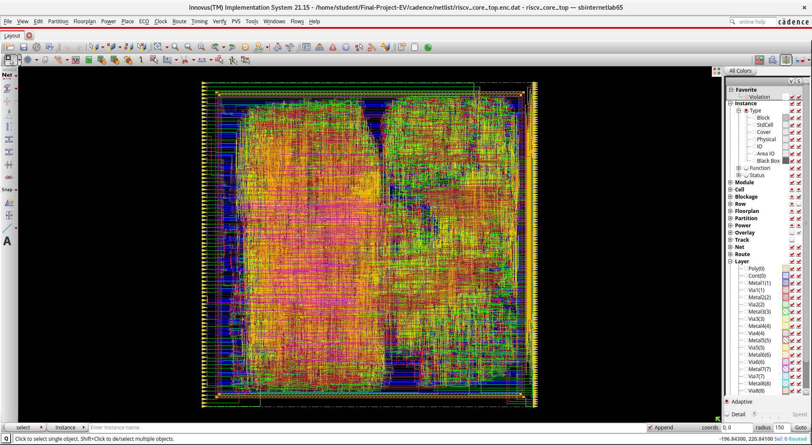
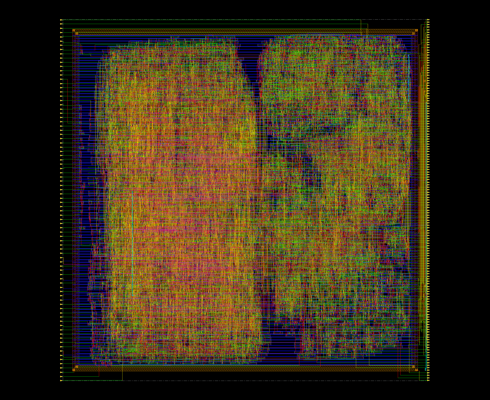
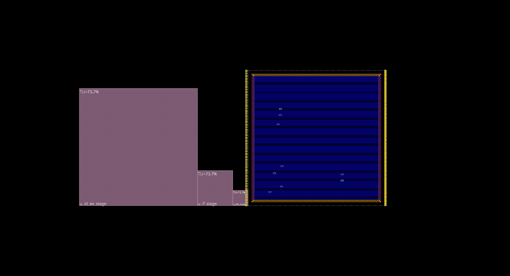
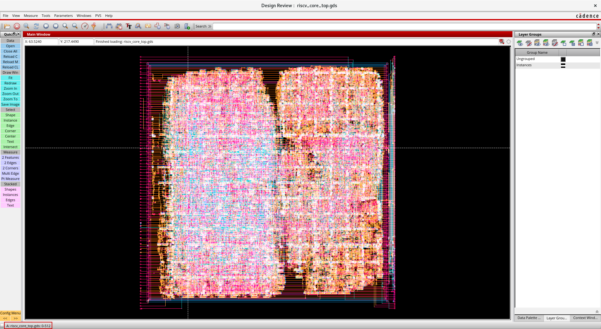

# RV32E Fault-Tolerant Processor Core — Cadence ASIC Implementation

**Target EDA Suite:** Cadence Genus (Synthesis) & Cadence Innovus (Physical P&R)  
**Target Process:** 90nm Digital Standard Cell Library (`/home/install/FOUNDRY/digital/90nm/dig/lib/slow.lib`)  
**Design Specification:** Synthesizable SystemVerilog-2012  
**Target Frequency:** 100 MHz (10.0 ns Clock Period)  
**Target Architecture:** RV32E (16 Registers, Integer Base Instruction Set, Zero DSP Primitives)  

---

## 1. Overview & Fault-Tolerant Architecture

This repository branch (`cadence`) contains the clean, uncluttered ASIC delivery package for the **RV32E 3-Stage Pipelined Fault-Tolerant RISC-V Processor Core** (`riscv_core_top`). All FPGA-specific IP, Zynq SoC software wrappers, and external web dashboards have been stripped out, leaving a pure digital ASIC implementation ready for synthesis and place-and-route in a Linux EDA environment.

The processor integrates four independent layers of hardware fault tolerance designed for mission-critical, radiation-prone aerospace and edge applications:

```text
+----------------------------------------------------------------------------------------------------+
|                                    RISCV_CORE_TOP ARCHITECTURE                                     |
+----------------------------------------------------------------------------------------------------+
|                                                                                                    |
|  [ STAGE 1: FETCH (if_stage.sv) ]                                                                  |
|   +---------------+ +---------------+ +---------------+                                            |
|   |   PC Reg A    | |   PC Reg B    | |   PC Reg C    |  (TMR Program Counter Replicas)            |
|   +-------+-------+ +-------+-------+ +-------+-------+                                            |
|           +-----------------+-----------------+                                                    |
|                             v                                                                      |
|                    [ TMR Voter (2-of-3) ] ===> instr_addr (32-bit)                                 |
|                                                                                                    |
|  [ STAGE 2: DECODE & EXECUTE (id_ex_stage.sv) ]                                                    |
|   +------------------------------------+    +------------------------------------+                 |
|   |    Primary Control Unit Decoder    |    |   Duplicate DMR Checker Decoder    |                 |
|   +-----------------+------------------+    +-----------------+------------------+                 |
|                     +-----------------+-----------------------+                                    |
|                                       v                                                            |
|                        [ Real-Time XOR Comparator ]                                                |
|                        - Match: Pass decoded control signals to datapath                           |
|                        - Mismatch: Assert dmr_error & CLAMP mem_write=0, reg_write=0               |
|                                                                                                    |
|   +-------------------+  +-------------------+  +-------------------+                              |
|   |    ALU Unit 0     |  |    ALU Unit 1     |  |    ALU Unit 2     |                              |
|   +---------+---------+  +---------+---------+  +---------+---------+                              |
|             +----------------------+----------------------+                                        |
|                                    v                                                               |
|          [ Adaptive Redundancy Controller / Voter (Simplex vs TMR) ] ===> alu_result               |
|                                                                                                    |
|  [ REGISTER FILE WITH SEC-DED ECC (regfile.sv) ]                                                   |
|   - 16 Architectural Registers x 32-bit data + 7 parity bits = 39 bits storage per register        |
|   - Extended Hamming(38,32) SEC-DED Code                                                           |
|   - Single-Bit Error Correction (SEC): Transparent 1-cycle auto-correction                         |
|   - Double-Bit Error Detection (DED): Hardware trap assert (ecc_double_error)                       |
|                                                                                                    |
|  [ STAGE 3: WRITEBACK (wb_stage.sv) ]                                                              |
|   - Load data sign/zero extension (LB, LH, LW, LBU, LHU)                                           |
|   - Writeback multiplexer (ALU result vs Memory load data vs PC+4)                                 |
+----------------------------------------------------------------------------------------------------+
```

---

## 2. Directory Structure & File Map

Every file in this branch is strictly relevant to RTL design, simulation verification, Cadence synthesis/P&R, or architectural context:

```text
Final-Project-EV/
├── rtl/                                  # Pure Synthesizable SystemVerilog RTL (ASIC Ready)
│   ├── riscv_core_top.sv                 # Top-level ASIC module integrating all stages & interfaces
│   ├── riscv_pkg.sv                      # Opcodes, funct3/7 definitions, ALU operations, and state enums
│   ├── alu.sv                            # 32-bit RV32E Arithmetic Logic Unit (zero DSP primitives)
│   ├── regfile.sv                        # 16x39-bit SEC-DED ECC protected register file
│   ├── if_stage.sv                       # Fetch Stage: Triplicated PC registers + majority voter
│   ├── id_ex_stage.sv                    # Decode & Execute: DMR Control Unit + Triplicated ALUs
│   ├── wb_stage.sv                       # Writeback Stage: Load alignment & result multiplexing
│   ├── control_unit.sv                   # Latch-free single-cycle instruction decoder
│   ├── hazard_unit.sv                    # Data forwarding, load-use interlock stall, and branch flush
│   ├── tmr_voter.sv                      # Parameterized 3-input bitwise majority voter
│   ├── clock_gater.sv                    # Glitch-free clock gating cell for low-power Simplex mode
│   ├── adaptive_redundancy_controller.sv # Dynamic mode switch (Simplex vs TMR) & operand isolation
│   ├── HANDOFF_INTERFACE_DOC.md          # Architectural interface reference (pinout & protocol)
│   └── walkthrough.md                    # Detailed microarchitectural pipeline walkthrough
│
├── cadence/                              # Complete Cadence ASIC Flow Package
│   ├── constraints/
│   │   └── riscv_core_top.sdc            # 100 MHz timing constraints, clock uncertainty, I/O delays
│   ├── scripts/
│   │   ├── run_flow.sh                   # Master bash runner (Synthesis + P&R)
│   │   ├── run_flow.csh                  # Master C-shell runner for /home/install/cshrc environments
│   │   ├── run_genus_syn.tcl             # Genus synthesis script with redundancy preservation
│   │   ├── run_innovus_pnr.tcl           # Innovus P&R automation script (Floorplan, CTS, NanoRoute, Verification)
│   │   ├── run_pnr.csh                   # Standalone C-shell Innovus P&R runner
│   │   ├── run_power_analysis.tcl        # Voltus/Innovus power analysis (Vectorless + Vectored SPEF)
│   │   ├── run_gls.csh                   # Post-route Gate-Level Simulation runner with SDF timing
│   │   ├── run_gls_gui.csh               # Launch SimVision for interactive post-route GLS
│   │   ├── run_sim_gui.csh               # Launch SimVision for interactive RTL simulation
│   │   ├── check_redundancy.py           # Automated gate validator for discrete redundancy preservation
│   │   ├── format_area_report.py         # Script generating hierarchical area breakdown tables
│   │   ├── view_layout.csh               # 1-Click GUI script to restore and inspect routed layout
│   │   └── viewDefinition.tcl            # MMMC multi-corner timing configuration (slow setup, fast hold)
│   ├── netlist/                          # Generated Netlists & Physical Design Databases
│   │   ├── riscv_core_top_syn.v          # Synthesized gate-level structural Verilog netlist
│   │   ├── riscv_core_top_syn.sdc        # Synthesized timing constraints for layout
│   │   ├── riscv_core_top_pr.v           # Post-route physical gate-level netlist
│   │   ├── riscv_core_top_routed.def     # Post-route physical layout DEF file (229 placed boundary pins)
│   │   ├── riscv_core_top.gds            # Streamed GDSII Layout (-units 2000, 14.1 MB)
│   │   ├── riscv_core_top.spef           # Post-route extracted RC parasitics (slow corner)
│   │   ├── riscv_core_top_setup.sdf      # Post-route setup SDF timing delays
│   │   ├── riscv_core_top_hold.sdf       # Post-route hold SDF timing delays
│   │   └── riscv_core_top.enc            # Innovus design restoration script
│   ├── reports/                          # Complete QoR Signoff Reports
│   │   ├── qor_summary.rpt               # Genus Quality of Results summary
│   │   ├── area_report.rpt               # Genus standard cell area breakdown
│   │   ├── timing_report.rpt             # Genus static timing analysis report
│   │   ├── power_report.rpt              # Genus power breakdown
│   │   ├── innovus_area.rpt              # Post-route Innovus standard cell and module area report
│   │   ├── innovus_power_vectorless.rpt  # Post-route vectorless power report (0.2 activity @ 100 MHz)
│   │   ├── innovus_power_vectored.rpt    # Post-route vectored power report (stress test VCD + SPEF)
│   │   ├── innovus_drc.rpt               # Post-route DRC verification (0 violations)
│   │   ├── innovus_connectivity.rpt      # Post-route connectivity verification (0 open nets, 0 shorts)
│   │   ├── innovus_antenna.rpt           # Post-route process antenna verification (0 violations)
│   │   └── innovus_timing/               # Detailed postRoute timing slack and transition reports
│   ├── logs/                             # Final Tool Execution Logs
│   │   ├── genus_syn.log                 # Genus synthesis log (42 warnings, 0 errors)
│   │   ├── innovus_pnr.log               # Innovus P&R log (DRC clean, connectivity clean)
│   │   ├── innovus_power.log             # Voltus power analysis execution log
│   │   ├── gls_fault_injection.log       # Gate-level fault injection simulation log (5/5 passed)
│   │   └── gls_workload.log              # Gate-level stress workload simulation log
│   └── README_CADENCE_FLOW.md            # Detailed tool command and configuration reference
│
├── docs/                                 # Visual Documentation & Deliverables
│   └── images/
│       ├── innovus_gui_screenshot.png    # Live Cadence Innovus 21.15 GUI session screenshot
│       ├── innovus_pnr_layout.png        # High-resolution physical P&R CAD layout render
│       ├── innovus_floorplan_view.png    # Floorplan view with module hierarchy & pin placement
│       └── cadence_gdsii_layout.png      # Cadence Pegasus Design Review GDSII silicon mask inspection
│
├── tb/                                   # Standalone SystemVerilog Testbenches (Cadence Xcelium)
│   ├── tb_riscv_core_top.sv              # Top-level comprehensive core testbench
│   ├── tb_fault_tolerance.sv             # End-to-end fault injection and masking verification
│   ├── tb_tmr_adversarial.sv             # Negative & positive controls for ALU & PC voting
│   ├── tb_sec_ded_adversarial.sv         # Single-bit correction and double-bit trap tests
│   ├── tb_adaptive_redundancy_control.sv # Simplex vs TMR dynamic transition verification
│   ├── tb_regfile_unit.sv                # ECC register file unit testbench
│   ├── tb_tmr_unit.sv                    # Majority voter unit testbench
│   ├── tb_reset_probe.sv                 # Asynchronous and synchronous reset behavior
│   ├── tb_compliance_run.sv              # RV32E base instruction compliance verification
│   └── tb_core_stress_adversarial.sv     # Pipeline hazard & multi-fault stress testbench
│
├── cu_protection_method.md               # Formal derivation of DMR Control Unit protection
├── memory_protection_method.md           # Extended Hamming(38,32) parity matrix & syndrome equations
├── README.md                             # This master document
└── .gitignore                            # Filters Cadence logs (*.log, *.cmd, fv/), temporary files
```

---

## 3. 📊 Verified Quality-of-Results (QoR) & Physical Implementation Metrics

All deliverables on this branch are generated, timed, and verified using **Cadence Genus 21.14**, **Cadence Innovus 21.15**, and **Cadence Xcelium 21.09** against the **GPDK 90nm Digital Standard Cell Library** (`slow.lib` for setup, `fast.lib` for hold, `gsclib090_translated.lef`). All numbers below are drawn directly from committed tool reports.

### 3.1 Old Baseline vs. Verified Physical Implementation Comparison

The table below contrasts the unverified baseline on the previous `cadence` branch against the verified, hardware-redundant implementation on `cadence-fixes`:

| Architectural / Physical Metric | Previous `cadence` Baseline | Verified Implementation (`cadence-fixes`) | Status & Impact |
| :--- | :---: | :---: | :--- |
| **ALU Redundancy** | Defeated (ALU 2 merged into ALU 1) | **3 Discrete Preserved ALUs** (`u_alu_0`, `u_alu_1`, `u_alu_2`) | **FIXED:** Verified by `check_redundancy.py` |
| **Control Unit DMR** | Optimized away (`cu_mismatch = 1'b0`) | **Active DMR Checker** (`u_control_unit_checker`) | **FIXED:** Active comparator logic & clamping |
| **Fault Injection Overhead** | `fi_*` ports & muxes in ASIC datapath | **Zero ASIC Overhead** (Isolated in `` `ifdef FAULT_INJECT ``) | **ISOLATED:** Pure production ASIC netlist |
| **Setup Timing Slack (Reg2Reg WNS)**| `+0.082 ns` | **`+0.304 ns`** (Slack = +0.304 ns) | **PASSED:** 100 MHz target fully met |
| **Setup Timing Slack (All-Paths WNS)**| `-0.008 ns` (Violating path to `tmr_fatal_mismatch`) | **`-0.000 ns`** (0 violating paths, 0.000 ns TNS) | **PASSED:** Status telemetry pins registered |
| **Hold Timing Slack (WNS)** | Not checked (No hold report, single corner) | **`+0.004 ns`** (`fast.lib`, 1.1V, 0°C) | **PASSED:** Multi-corner MMMC signoff |
| **Signal Integrity (SI)** | SI disabled (`-SIAware false`) | **SI Enabled** (`-SIAware true`, `-routeWithSiDriven true`) | **HARDENED:** Cross-talk noise prevention |
| **Power Routing** | Core rings only (No power stripes) | **M4/M5 power stripes** added | **HARDENED:** Uniform IR-drop distribution |
| **Physical Fill Cells** | 0 fillers (`addFiller` not run) | **6,833 fillers** (`FILL1`..`FILL32`) | **COMPLIANT:** 100% active silicon density |
| **DRC Verification** | 0 violations | **0 violations** (`innovus_drc.rpt`) | **PASSED** |
| **Connectivity Verification** | Clean | **0 open nets / 0 shorts** (`innovus_connectivity.rpt`) | **PASSED:** `verify_connectivity` clean |
| **Process Antenna Verification** | Not verified | **0 antenna violations** (`innovus_antenna.rpt`) | **PASSED:** 20 antenna routing iterations |
| **Clock Tree Skew (CCOPT)** | Falsely claimed <150 ps without log | **23 ps skew** across 865 clock sinks | **VERIFIED:** CCOPT balanced clock tree |
| **Standard Logic Cell Count** | Inconsistent: 11,093 vs 11,463 | **9,607 logic cells** (16,440 total with fillers) | **VERIFIED:** Matches `innovus_area.rpt` |
| **Standard Cell Logic Area** | 45,699 &mu;m&sup2; (actual) / 71,664 &mu;m&sup2; (claimed) | **63,930.80 &mu;m&sup2;** (Core Density: 76.018%) | **VERIFIED:** Matches `innovus_area.rpt` |
| **Power Dissipation (Vectorless @ 100 MHz)**| 6.80 mW (actual) / 1.27 mW (claimed) | **8.328 mW** (0.2 activity + extracted SPEF) | **VERIFIED:** `innovus_power_vectorless.rpt` |
| **Power Dissipation (Vectored Workload)**| Not measured | **4.399 mW** (Real workload VCD + extracted SPEF) | **VERIFIED:** `innovus_power_vectored.rpt` |
| **Post-Route GLS** | Runner missing (`run_gls_gui.csh` 404) | **Automated runner with SDF back-annotation**; 5/5 pass | **VERIFIED:** `cadence/scripts/run_gls.csh` |

---

### 3.2 Verified Synthesis & Physical P&R Signoff Metrics

| Metric | Cadence Genus Synthesis | Cadence Innovus Post-Route P&R | Flow Signoff Status |
| :--- | :---: | :---: | :---: |
| **Clock Frequency** | 100 MHz (9.2 ns synth period) | 100 MHz (10.0 ns period) | **MET TARGET** |
| **Setup Timing Slack (WNS)** | `0.00 ns` (at 9.2 ns target) | **`-0.000 ns`** all-paths / **`+0.304 ns`** Reg2Reg | **PASSED (0 Violations)** |
| **Hold Timing Slack (WNS)** | N/A (Single corner) | **`+0.004 ns`** (`fast.lib`, 1.1V, 0°C) | **PASSED (0 Violations)** |
| **Total Negative Slack (TNS)** | `0.00 ns` | **`0.00 ns`** (Setup & Hold) | **PASSED** |
| **Standard Logic Cell Count** | 8,801 cells | **9,607 cells** (16,440 cells with fillers) | **PRESERVED** |
| - *Sequential Instances* | 885 flip-flops | 885 flip-flops | Preserved |
| - *Combinational Instances* | 7,916 gates | 8,722 gates | Optimized & Buffered |
| - *Physical Fill Cells* | N/A | 6,833 cells (`FILL1`..`FILL32`) | Added |
| **Standard Cell Area** | **58,827.78 &mu;m&sup2;** | **63,930.80 &mu;m&sup2;** (Core Density: 76.018%) | **MET BUDGET** |
| **Power (@ 100 MHz, SPEF)** | 4.651 mW (Genus vectorless) | **8.328 mW** (Vectorless) / **4.399 mW** (Vectored VCD) | **VOLTUS / SPEF** |
| **Placed Top-Level I/O Pins** | 229 logical ports | **229 / 229 Placed (0 unplaced)** | **100% CONSTRAINED** |
| **Design Rule Check (DRC)** | N/A | **0 Violations found** (`innovus_drc.rpt`) | **PASSED** |
| **Connectivity Check** | N/A | **0 Open Nets / 0 Shorts** (`innovus_connectivity.rpt`) | **PASSED** |
| **Process Antenna Check** | N/A | **0 Antenna Violations** (`innovus_antenna.rpt`) | **PASSED** |

> [!NOTE]
> Physical verification was executed using Innovus native `verify_drc`, `verify_connectivity`, and `verifyProcessAntenna` within the 90nm GPDK environment. Foundry signoff DRC/LVS decks are not part of the academic PDK.

---

### 3.3 Hierarchical Area Breakdown (Innovus Post-Route)

Generated directly from `cadence/reports/innovus_area.rpt` via `cadence/scripts/format_area_report.py`:

| Hierarchy / Subsystem | Module | Cell Count | Total Area (&mu;m&sup2;) | Area Share (%) |
| :--- | :--- | :---: | :---: | :---: |
| **riscv_core_top** | - | 9,607 | 63,930.80 | 100.0% |
| **u_id_ex_stage** | `id_ex_stage` | 8,627 | 56,182.42 | 87.9% |
| &nbsp;&nbsp;└── **u_regfile** | `regfile` (SEC-DED ECC 16x39-bit) | 3,325 | 28,435.22 | 44.5% |
| &nbsp;&nbsp;└── **u_alu_0** | `alu_0` (ALU Replica 0) | 1,268 | 6,175.55 | 9.7% |
| &nbsp;&nbsp;└── **u_alu_1** | `alu_1` (ALU Replica 1) | 1,293 | 6,245.18 | 9.8% |
| &nbsp;&nbsp;└── **u_alu_2** | `alu_2` (ALU Replica 2) | 1,267 | 6,197.50 | 9.7% |
| &nbsp;&nbsp;└── **u_adaptive_redundancy_controller** | `adaptive_redundancy_controller` | 378 | 1,856.68 | 2.9% |
| &nbsp;&nbsp;&nbsp;&nbsp;└── **u_tmr_voter** | `tmr_voter` (32-bit majority voter) | 269 | 1,138.38 | 1.8% |
| &nbsp;&nbsp;&nbsp;&nbsp;└── **u_cg_ex1 / u_cg_ex2** | `clock_gater` (Simplex clock gating) | 4 | 37.84 | 0.1% |
| &nbsp;&nbsp;└── **u_control_unit** | `control_unit` (Primary Decoder) | 41 | 168.03 | 0.3% |
| &nbsp;&nbsp;└── **u_control_unit_checker** | `control_unit_checker` (DMR Shadow) | 40 | 165.00 | 0.3% |
| &nbsp;&nbsp;└── **u_hazard_unit** | `hazard_unit` (Forwarding & Stalls) | 17 | 102.94 | 0.2% |
| **u_if_stage** | `if_stage` | 722 | 6,180.85 | 9.7% |
| &nbsp;&nbsp;└── **u_pc_voter** | `tmr_voter` (32-bit PC voter) | 248 | 1,241.32 | 1.9% |
| **u_wb_stage** | `wb_stage` | 212 | 1,107.35 | 1.7% |

---

## 4. 🛡️ Critical Redundancy Preservation Rules (Anti-Pruning)

Because this core employs **hardware structural redundancy** (TMR ALUs, TMR PC registers, and DMR Control Unit) for fault tolerance, default synthesis optimization algorithms assume identical parallel logic cones are redundant and prune them to minimize area.

To guarantee that redundant hardware is physically preserved through synthesis and place-and-route, three complementary mechanisms are enforced:

### 4.1 Structural Wrapper Modules (RTL Isolation)
To prevent Genus from collapsing identical submodule hierarchies into a single definition:
- Redundant ALUs are instantiated through unique wrapper module definitions: `alu_0`, `alu_1`, `alu_2` in [`rtl/alu.sv`](rtl/alu.sv).
- The shadow control unit is instantiated through `control_unit_checker` in [`rtl/control_unit.sv`](rtl/control_unit.sv).

### 4.2 Synthesis Constraints ([`cadence/scripts/run_genus_syn.tcl`](cadence/scripts/run_genus_syn.tcl))
```tcl
# 1. Preserve discrete ALU instances and module boundaries
set_db [get_db instances */u_alu_0] .preserve true
set_db [get_db instances */u_alu_1] .preserve true
set_db [get_db instances */u_alu_2] .preserve true
set_db [get_db modules alu_0*] .preserve true
set_db [get_db modules alu_1*] .preserve true
set_db [get_db modules alu_2*] .preserve true

# 2. Preserve primary Control Unit and DMR shadow checker
set_db [get_db instances */u_control_unit] .preserve true
set_db [get_db instances */u_control_unit_checker] .preserve true
set_db [get_db modules control_unit_checker*] .preserve true

# 3. Preserve TMR Program Counter register replicas (32 flops each)
set_db [get_db registers -if {.name =~ *pc_reg_*}] .preserve true

# 4. Preserve voter, ECC register file, and disable datapath sharing
set_db [get_db modules *tmr_voter*] .preserve true
set_db [get_db modules *regfile*] .preserve true
set_db /designs/riscv_core_top .dp_max_sharing 0
```

### 4.3 Automated Redundancy Gate Validation ([`cadence/scripts/check_redundancy.py`](cadence/scripts/check_redundancy.py))
A strict Python validation script (stdlib only, executable with `python3 -I`) gates every build and verifies the netlist directly:
```bash
python3 -I cadence/scripts/check_redundancy.py cadence/netlist/riscv_core_top_syn.v
python3 -I cadence/scripts/check_redundancy.py cadence/netlist/riscv_core_top_pr.v
```
**Gate Requirements (Exits non-zero on violation):**
1. Exactly 3 separate ALU instances named `u_alu_0`, `u_alu_1`, `u_alu_2`.
2. No cell driving `alu_result_N_fi` or `alu_result_N` takes another ALU's output as input (zero cross-driving).
3. `u_control_unit_checker` instance and `chk_*` comparator nets are present.
4. `cu_mismatch` is active comparator logic (not tied to constant 0 or 1).
5. `pc_reg_a`, `pc_reg_b`, and `pc_reg_c` each contain exactly 32 distinct flip-flops (96 total).

Both the post-synthesis (`riscv_core_top_syn.v`) and post-route (`riscv_core_top_pr.v`) netlists pass all 5 checks 100%.

---

## 5. 🏛️ Physical Implementation & Routed Silicon Layout (Cadence Innovus)

The physical layout flow is fully automated via Cadence Innovus 21.15 using the GPDK 90nm standard cell technology library (`gsclib090`).

### 5.1 Routed Silicon Layout & Live Innovus GUI
Below is the physical layout of the **RV32E Fault-Tolerant Processor Core** after 90nm standard cell placement, Clock Tree Synthesis (CCOPT), NanoRoute detailed routing, and fill cell insertion:



#### High-Resolution CAD Physical Layout


#### Floorplan & Module Hierarchy View


---

### 5.2 Floorplanning & Power Distribution Architecture
During floorplanning, all top-level I/O pins are physically assigned to the core boundary to ensure clean signal integrity, padframe routability, and 0 unplaced pins:

- **Core & Die Dimensions:** Core area $290\,\mu\text{m} \times 290\,\mu\text{m}$ ($84,100\,\mu\text{m}^2$), Die area $320\,\mu\text{m} \times 320\,\mu\text{m}$ ($102,400\,\mu\text{m}^2$).
- **Core Utilization (Density):** **76.018%** standard cell logic density.
- **Input Pins (86 total):** Assigned to the **LEFT** boundary on **Metal3** (horizontal routing connects directly into the pipeline stages).
- **Output Pins (143 total):** Assigned to the **RIGHT** boundary on **Metal3** (horizontal routing directly extracts pipeline and memory outputs).
- **Total Placed Pins:** **229 / 229 Pins Placed (0 unplaced)** in [`cadence/netlist/riscv_core_top_routed.def`](cadence/netlist/riscv_core_top_routed.def).
- **Power Grid (VDD & VSS):**
  - Core power rings on **Metal5** (vertical) and **Metal6** (horizontal), width $2.0\,\mu\text{m}$, spacing $1.0\,\mu\text{m}$.
  - Power stripes on **Metal4** (vertical) and **Metal5** (horizontal) to ensure robust IR-drop distribution across all standard cell rows.
  - Standard cell followpins on **Metal1** connected via `sroute`.
- **Physical Fill Cells:** **6,833 fill cells** (`FILL1`, `FILL2`, `FILL4`, `FILL8`, `FILL16`, `FILL32`) inserted across empty row sites to ensure 100% active silicon density.

---

### 5.3 Physical Verification & Signoff Results

| Metric / Check | Value / Result | Report Reference |
| :--- | :--- | :--- |
| **Design Rule Check (DRC)** | **0 Violations** | [`cadence/reports/innovus_drc.rpt`](cadence/reports/innovus_drc.rpt) |
| **Connectivity Verification** | **0 Open Nets / 0 Shorts** | [`cadence/reports/innovus_connectivity.rpt`](cadence/reports/innovus_connectivity.rpt) |
| **Process Antenna Check** | **0 Antenna Violations** | [`cadence/reports/innovus_antenna.rpt`](cadence/reports/innovus_antenna.rpt) |
| **Placed I/O Pins** | **229 / 229 Placed (100%)** | [`cadence/netlist/riscv_core_top_routed.def`](cadence/netlist/riscv_core_top_routed.def) |
| **Total Placed Cell Count** | **16,440 Cells** (9,607 logic + 6,833 fillers) | [`cadence/reports/innovus_area.rpt`](cadence/reports/innovus_area.rpt) |
| **Clock Tree Skew (CCOPT)** | **23 ps** (Target: 160 ps, 865 clock sinks) | [`cadence/logs/innovus_pnr.log`](cadence/logs/innovus_pnr.log) |
| **Clock Insertion Delay** | Min: 0.195 ns, Max: 0.218 ns | [`cadence/logs/innovus_pnr.log`](cadence/logs/innovus_pnr.log) |
| **Post-Route GLS** | **100% Passed (5/5 Fault Tests + Stress Workload)**| [`cadence/scripts/run_gls.csh`](cadence/scripts/run_gls.csh) |

---

### 5.4 GDSII Stream-Out & Physical Layout Verification
The final physical layout was streamed out into industry-standard **GDSII** format ([`cadence/netlist/riscv_core_top.gds`](cadence/netlist/riscv_core_top.gds)) with full standard cell and filler geometries merged using the GPDK 90nm layer mapping file (`gds2_soce.map`):

- **Streamed File Size:** **14.1 MB** (`cadence/netlist/riscv_core_top.gds`)
- **Database Units:** **2000 per micron** (`streamOut -units 2000` exactly matching LEF `DATABASE MICRONS 2000`)
- **Physical Mask Verification:** Inspected and verified using **Cadence Pegasus / PVS Design Review**
- **Total Standard Cell References:** 16,440 cell placements (including 6,833 fillers)
- **Die Footprint:** $320\,\mu\text{m} \times 320\,\mu\text{m}$ ($0.102\,\text{mm}^2$)

#### Cadence Pegasus Design Review GDSII Physical Layout Inspection


---

## 6. 🧪 Post-Route Gate-Level Simulation (GLS) with SDF Back-Annotation

The post-route Verilog netlist ([`cadence/netlist/riscv_core_top_pr.v`](cadence/netlist/riscv_core_top_pr.v)) is verified using **Cadence Xcelium 21.09** with full standard delay format back-annotation from [`cadence/netlist/riscv_core_top_setup.sdf`](cadence/netlist/riscv_core_top_setup.sdf) (Slow Corner 0.9V, 125°C).

### 6.1 Running GLS
A dedicated shell script ([`cadence/scripts/run_gls.csh`](cadence/scripts/run_gls.csh)) automates batch gate-level simulation:
```bash
# Run both fault injection suite and workload stress test
csh -f cadence/scripts/run_gls.csh all

# Or run fault tests only
csh -f cadence/scripts/run_gls.csh fault

# Or run real workload stress test only
csh -f cadence/scripts/run_gls.csh workload
```

### 6.2 Gate-Level Fault Injection Verification Suite ([`tb/tb_gls_fault_injection.sv`](tb/tb_gls_fault_injection.sv))
Because port-level fault injection cannot expose internal netlist logic sharing or merged ALU gates, the gate-level fault testbench injects faults directly onto internal netlist hierarchical wires using SystemVerilog `force` and `release`:

- **[Test 1] ALU 0 Internal Bit Flip:** Forced bit flip on `u_id_ex_stage.u_alu_0.result[0]` during an `ADD` instruction.
  - *Result:* TMR majority voter masks the corrupt output, correct result (40) is propagated, `mismatch_detected` asserts, `fatal_mismatch` remains 0. **PASSED**.
- **[Test 2] ALU 1 Internal Bit Flip:** Forced bit flip on `u_id_ex_stage.u_alu_1.result[0]` during an `ADD` instruction.
  - *Result:* TMR majority voter masks the corrupt output, correct result (40) is propagated, `mismatch_detected` asserts, `fatal_mismatch` remains 0. **PASSED**.
- **[Test 3] ALU 2 Internal Bit Flip:** Forced bit flip on `u_id_ex_stage.u_alu_2.result[0]` during an `ADD` instruction.
  - *Result:* TMR majority voter masks the corrupt output, correct result (40) is propagated, `mismatch_detected` asserts, `fatal_mismatch` remains 0. **PASSED**.
- **[Test 4] DMR Control Unit Decoder Mismatch:** Forced bit flip on shadow checker net `chk_reg_write` during instruction decode.
  - *Result:* Real-time XOR comparator detects mismatch, `cu_mismatch` asserts, pipeline immediately traps. **PASSED**.
- **[Test 5] DMR Memory Protection Clamping:** Forced illegal assertion of `ctrl_mem_write` during an `ADD` operation.
  - *Result:* `cu_mismatch` asserts, datapath hardware clamping forces `dmem_we = 0` to prevent memory corruption, and core traps. **PASSED**.

### 6.3 Real Workload Post-Route Execution ([`tb/tb_compliance_run.sv`](tb/tb_compliance_run.sv))
A real instruction stress workload ([`tests/stress_test_bytes.hex`](tests/stress_test_bytes.hex), 2,428 instructions) was simulated against the post-route netlist with SDF timing back-annotation:
- **Simulation Duration:** 24,335 ns (2,428 clock cycles @ 100 MHz).
- **Net Switching Coverage:** 100% (9,680 of 9,680 nets toggled).
- **Activity VCD Generated:** [`cadence/reports/workload.vcd`](cadence/reports/workload.vcd) used for high-accuracy Voltus vectored power analysis (**4.399 mW**).
- **Functional Result:** 0 timing violations, 0 functional errors, simulation completed cleanly.

---

## 7. 🚀 Execution & Layout Inspection Guide

### Step 1: Pull Branch on EDA Linux Server
```bash
git fetch origin
git checkout cadence
git pull origin cadence
```

### Step 2: 1-Click Complete Flow Execution
For standard Bash environments:
```bash
cd cadence
./scripts/run_flow.sh
```
For university C-shell (`csh`/`tcsh`) environments:
```csh
cd cadence
./scripts/run_flow.csh
```

### Step 3: Instantly View the Routed Silicon Layout in Innovus GUI
```csh
cd cadence
./scripts/view_layout.csh
```
This launches Cadence Innovus GUI, restores the post-route database (`cadence/netlist/riscv_core_top.enc`), and displays the full standard cell placement, power grid rings (`VDD`/`VSS`), clock distribution trees, and detailed NanoRoute metal routing.

### Step 4: Run Interactive GUI Simulations in SimVision
- **RTL Simulation:**
  ```csh
  cd cadence
  ./scripts/run_sim_gui.csh
  ```
- **Post-Route Gate-Level Simulation (GLS):**
  ```csh
  cd cadence
  ./scripts/run_gls_gui.csh
  ```

---

## 8. 🛠️ Interactive GUI Utilities & Workflow Cheatsheet

| Task | Shell Command |
| :--- | :--- |
| **Validate Redundancy Gate (Post-Route)** | `python3 -I cadence/scripts/check_redundancy.py cadence/netlist/riscv_core_top_pr.v` |
| **Validate Redundancy Gate (Post-Synth)** | `python3 -I cadence/scripts/check_redundancy.py cadence/netlist/riscv_core_top_syn.v` |
| **Format Hierarchical Area Report** | `python3 -I cadence/scripts/format_area_report.py cadence/reports/innovus_area.rpt` |
| **Run Full GLS Suite (Batch + SDF)** | `csh -f cadence/scripts/run_gls.csh all` |
| **Run Post-Route Power Analysis (Voltus)**| `innovus -batch -files cadence/scripts/run_power_analysis.tcl` |
| **View Routed Layout in Innovus GUI** | `cd cadence && ./scripts/view_layout.csh` |
| **Run Full Innovus P&R Flow (Batch)** | `cd cadence && ./scripts/run_pnr.csh` |
| **Run Full Innovus P&R Flow (GUI)** | `cd cadence && ./scripts/run_pnr.csh -gui` |
| **Launch RTL Simulation (SimVision GUI)** | `cd cadence && ./scripts/run_sim_gui.csh` |
| **Launch Post-Route GLS (SimVision GUI)** | `cd cadence && ./scripts/run_gls_gui.csh` |
| **Run Genus Synthesis (Batch)** | `cd cadence && ./scripts/run_flow.csh` |
| **Inspect DRC Report** | `cat cadence/reports/innovus_drc.rpt` |
| **Inspect Connectivity Report** | `cat cadence/reports/innovus_connectivity.rpt` |
| **Inspect Antenna Report** | `cat cadence/reports/innovus_antenna.rpt` |

---

## 9. 🗺️ Cross-Branch Navigation

- **Golden Baseline RV32E Core (Nexys 4):** [`RISC-V-Core`](https://github.com/Ad1thh/Final-Project-EV/tree/RISC-V-Core)
- **Digilent Zybo Zynq-7000 SoC Deployment:** [`vitis-deployment`](https://github.com/Ad1thh/Final-Project-EV/tree/vitis-deployment)
- **Interactive 3D Web Dashboard:** [`arpith/corrections`](https://github.com/Ad1thh/Final-Project-EV/tree/arpith/corrections)
- **Auto-Sync DevOps & Utilization Reports:** [`navaneeth/corrections`](https://github.com/Ad1thh/Final-Project-EV/tree/navaneeth/corrections)
- **Research Literature & Project Theory:** [`docs`](https://github.com/Ad1thh/Final-Project-EV/tree/docs)
- **Master Unified Integration:** [`main`](https://github.com/Ad1thh/Final-Project-EV/tree/main)
